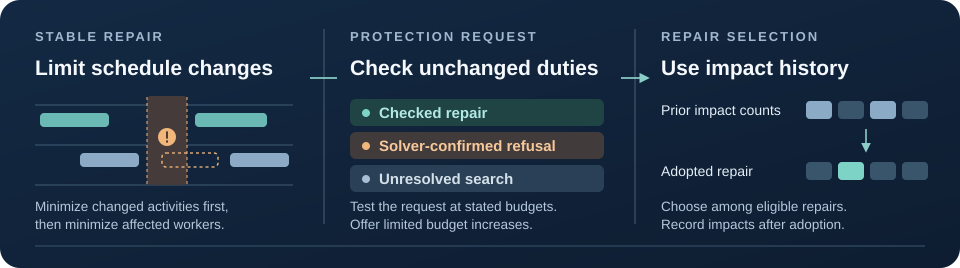

<h1 align="center">Participant Protection in Stable Schedule Repair</h1>

<p align="center">Code, synthetic experimental data, and verification scripts</p>

<p align="center">
  <a href="#quick-start"><strong>Quick start</strong></a> ·
  <a href="#results-and-data"><strong>Results and data</strong></a> ·
  <a href="versions/v37/README.md"><strong>Reproduction guide</strong></a> ·
  <a href="https://github.com/sxxl0326-collab/participant-protection-schedule-repair/releases/tag/v1.0.1-code-data"><strong>Fixed release</strong></a>
</p>

<p align="center">
  
</p>

After a worker outage, equally stable schedules can change different people's duties. This project lets a coordinator check a request to keep specific duties unchanged, consider a small increase in the change budget, and use prior impact counts to choose among eligible repairs.

## Quick start

The [fixed release](https://github.com/sxxl0326-collab/participant-protection-schedule-repair/releases/tag/v1.0.1-code-data) pins the code and data used in the study. Clone it to run either workflow below.

```sh
git clone --branch v1.0.1-code-data --single-branch https://github.com/sxxl0326-collab/participant-protection-schedule-repair.git
cd participant-protection-schedule-repair/versions/v37
```

### Verify the saved experiments

**Python 3.10+** and its standard library suffice. After download, verification runs offline.

```sh
python -B verify.py
python -B verify_design_details.py
```

Expect `"status": "PASS"` and `"solver_calls": 0`. The checks cover 10,000 matched policy-days and 5,000 closed-loop policy-days, rebuild three numerical CSVs, and recount design details from the saved data. See the [verification scope and outputs](versions/v37/docs/reproduction.md).

### Run a new protection request

Install **OR-Tools 9.11.4210** in a Python environment, then query the supplied synthetic outage. The solver uses one CPU worker.

```sh
python -m pip install -r requirements.txt
python -B demo.py --protect W8
```

The example writes `demo_output.json` with the setup status, budget-menu responses, and any returned repair. See [example commands and output fields](versions/v37/README.md#run-a-new-query).

## Results and data

| Paper item | Where to start |
| --- | --- |
| Table II · Protection and selection | [Matched requests and delivery counts](versions/v37/results/table_II.csv) |
| Table III · Base protection maps | [Scale summary in the saved archive](versions/v37/docs/reproduction.md#figure-and-table-index) |
| Table IV · Matched requests | [Impact, displacement, and solver statuses](versions/v37/results/table_III.csv) |
| Table V · Own-history replay | [Delivery, concessions, and cumulative impact](versions/v37/results/table_IV_closedloop.csv) |
| Figs. 1–4 · Examples, delivery, refusal evidence, and impact | [Evidence locations by figure](versions/v37/docs/reproduction.md#figure-and-table-index) |

[Browse the implementation](versions/v37/src) · [Get the saved-data archive](versions/v37/data/saved_results.zip) · [Read the experimental design](versions/v37/docs/experimental_design.md) · [Read the data provenance](versions/v37/docs/data.md)

The experiments use MSLIB v2.2 project models and synthetic outages and requests. Replay checks saved schedules and counts. Saved solver statuses are evidence from the solver runs. Independent arithmetic checks cover the documented Hall and temporal cases.
